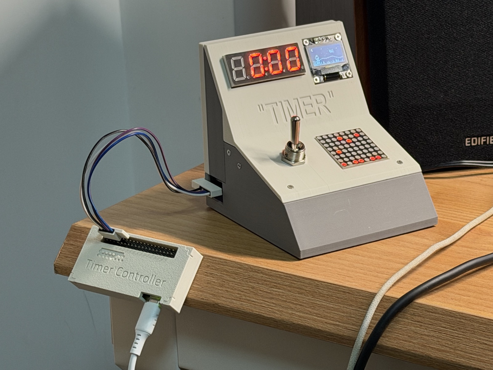
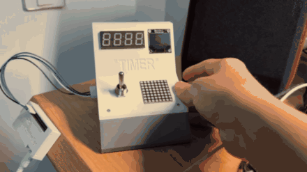
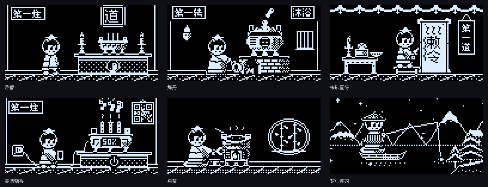
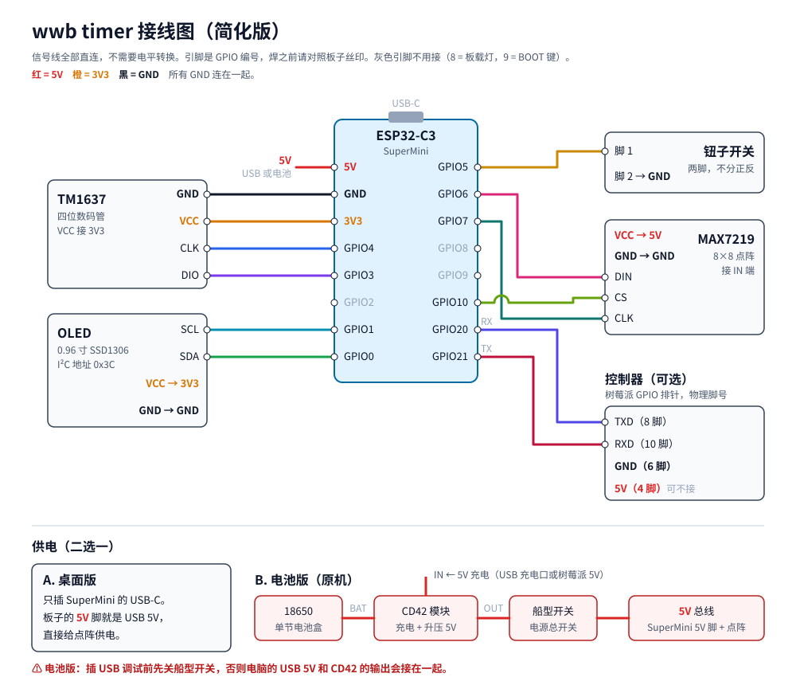

<p align="center"><b>English</b> · <a href="README.zh-CN.md">简体中文</a></p>

<h1 align="center">wwb timer</h1>

<p align="center">
  A desk gadget that starts timing when you flip a switch: ESP32-C3 + OLED + 4-digit display + 8×8 LED matrix.<br>
  On its own it is a timer; plug in a Raspberry Pi and it becomes a programmable three-display terminal.
</p>

<p align="center">
  <a href="https://zijie-duan.github.io/wwb_timer/"><b>▶ Try it online</b></a> ·
  <a href="docs/build.md"><b>🔧 Build one</b></a> ·
  <a href="https://github.com/ZiJie-Duan/wwb_timer/releases"><b>⬇ Firmware</b></a>
</p>

<p align="center">
  
</p>

<p align="center">
  
  
  
  
</p>

## What it does

<p align="center">
  <br>
  <sub>Power on, boot animation, flip the switch to start timing</sub>
</p>

- **Flip up to start, flip down to stop.**  
  The 4-digit display shows total `hours:minutes`, the OLED shows seconds and a one-minute progress bar, and every completed on → off session lights one more dot on the matrix. Time is stored on the chip and survives power loss.

- **Plug in a controller for more.**  
  A Raspberry Pi takes over all three displays over serial and runs Python programs. Unplug it and the chip's own timer takes back over; timing never stops.

- **dao timer, a Taoist cyber timer.**  
  Flip up to start a ritual (burning incense, drawing talismans, alchemy… 55 kinds), flip down to rest (brewing tea, listening to rain, fishing on a winter river… 54 kinds). All in 1-bit pixel art.

- **Web simulator.**  
  No hardware needed: the chip's timer is also compiled to WebAssembly, so the browser runs the exact same code.

- **Fast serial API.**  
  A binary protocol drives the displays at up to 95 fps full-frame on the OLED and about 27,000 frames/s on the matrix. Use it for your own programs.

<p align="center"></p>

## Build one

No custom PCB and no etching: every chip is on an off-the-shelf module, so it is about twenty wires following the diagram below. Parts cost about **¥45 (~$6)** for the desk version and **¥70 (~$10)** with a battery, not counting the print and the Raspberry Pi.

<p align="center"><a href="docs/build.md#2-wiring"></a></p>

[**Build guide →**](docs/build.md): bill of materials, wiring, power, 3D-printed enclosure, assembly, flashing, troubleshooting.

| Part | Model |
|---|---|
| MCU | ESP32-C3 SuperMini |
| OLED | 0.96" SSD1306, I²C |
| 4-digit display | TM1637, 0.56", with colon |
| LED matrix | MAX7219 8×8 |
| Switch | toggle switch (any 2-pin switch) |
| Battery version | 18650 + CD42 charge/boost module + rocker switch |
| Controller (optional) | Raspberry Pi Zero 2 W |
| Enclosure | 3D printed; Fusion 360 source in [`hardware/enclosure/`](hardware/enclosure/) |

## Quick start

**Flash the firmware**: download the `.bin` from [Releases](https://github.com/ZiJie-Duan/wwb_timer/releases), then

```bash
pip install esptool
esptool --chip esp32c3 write_flash 0x0 wwb_timer-v0.2.0-esp32c3.bin
```

or build from source: `pip install platformio && cd firmware && pio run -t upload`.

**Control it from a computer** (the serial port is detected automatically; on a Raspberry Pi set `WWB_PORT=/dev/serial0`):

```bash
pip install -e host
python -m wwb info                   # device info
python -m wwb text "hello" -f 5      # write on the OLED (Chinese works too)
python -m wwb seg 12:34              # 4-digit display
python -m wwb events                 # print switch events live
python -m wwb.showcase               # cyberpunk multi-scene demo (flip the switch to change scene)
python -m apps.dao                   # dao timer
```

**Run it in the browser, no device**:

```bash
python -m wwb.sim                    # open http://127.0.0.1:8765, pick a program on the right; click or press Space to flip the switch
```

With no program running, the page runs the chip's own offline timer (WebAssembly); running a Python program is the same as plugging in a controller. The simulator executes protocol commands exactly as the firmware does and models the real refresh timing, within about 1% of the hardware. Programs live in `apps/<name>/`; add `--port sim` to run one in the simulator, drop it to run on the device. See [docs/simulator.md](docs/simulator.md).

## Docs

| Doc | Contents |
|---|---|
| [build.md](docs/build.md) | **Build guide** |
| [hardware.md](docs/hardware.md) | Parts, GPIO map, power, measurements from the original unit |
| [offline.md](docs/offline.md) | The on-chip timer: controls, animations, writing offline programs |
| [dao.md](docs/dao.md) | dao timer: rules and the full scene list |
| [simulator.md](docs/simulator.md) | Web simulator |
| [raspberrypi.md](docs/raspberrypi.md) | Raspberry Pi as controller (UART), autostart |
| [protocol.md](docs/protocol.md) | Serial protocol spec |
| [benchmarks.md](docs/benchmarks.md) | Performance limits, measured |

Every doc has a Chinese version (`*.zh-CN.md`).

## Repository layout

```
firmware/            ESP32-C3 firmware (PlatformIO + Arduino 3.3 / ESP-IDF 5.5)
  src/board.h        pin map
  src/proto.*        frame format, opcodes, COBS/CRC
  src/transport.*    USB-Serial/JTAG and UART1 transport
  src/oled.*         SSD1306: framebuffer + dirty rectangles + push task
  src/seg.*          TM1637: timer-interrupt driven, writes only changed digits
  src/matrix.*       MAX7219: hardware SPI, rotation, writes only changed rows
  src/io.*           switch / BOOT button (interrupt timestamps) + onboard LED
  src/main.cpp       command dispatch, INFO/STATS, on-device self tests
  src/offline.*      runtime for the offline program on the chip (controller takeover, NVS storage)
native/              offline program (C++, shared by chip and browser)
  wwb/               framework: Device, Canvas (u8g2), App, Runtime
  timer/             wwb timer
  web/, build_web.py WebAssembly build (web/js/native.js)
host/wwb/            Python host library
  device.py          Device class: the whole command API
  protocol.py        protocol constants and codec
  bench.py           performance limit tests
  maxdemo.py         all three displays at full speed
  showcase.py        cyberpunk multi-scene demo
  cli.py             command line
  remote.py          sync a program to a Raspberry Pi and run it there (UART)
  sim.py             Python bridge for the web simulator
  app.py             program entry point run(main)
apps/                programs, one package each (stopwatch; dao: the Taoist timer)
web/                 web simulator
hardware/enclosure/  enclosure Fusion 360 source
docs/                docs and images
results/             raw benchmark data (JSON)
```

## Key numbers

| | Limit |
|---|---|
| USB round trip | 0.28 ms |
| OLED full frame / partial | 95 fps / 236 fps (4×96 region) |
| 4-digit display | 390 updates/s full, 800/s single digit |
| LED matrix | ~27,000 frames/s (batched) |
| All three at full speed | OLED 91 fps + digits 666/s + matrix 14,730/s |
| All three capped at 320 | OLED 96 fps + digits 319.7/s + matrix 319.7/s, no dropped frames |
| Switch event timestamps | µs resolution (start of bounce) |

See [docs/benchmarks.md](docs/benchmarks.md).

## Notes

- Battery version: switch the power off before plugging in USB for debugging, or the computer's USB 5V gets tied to the battery boost output. See [docs/build.md](docs/build.md#3-power).
- ESP32-C3 pins are not 5V tolerant: a TM1637 powered from 5V needs a level shifter; the simplified wiring powers it from 3.3V instead.
- On Linux / macOS the serial port must be opened with DTR and RTS both asserted and HUPCL off, or the chip resets. `wwb.Device` handles this.

## License

[MIT](LICENSE). The Fusion Pixel font used by dao timer is under the OFL, see `apps/dao/assets/fonts`.
