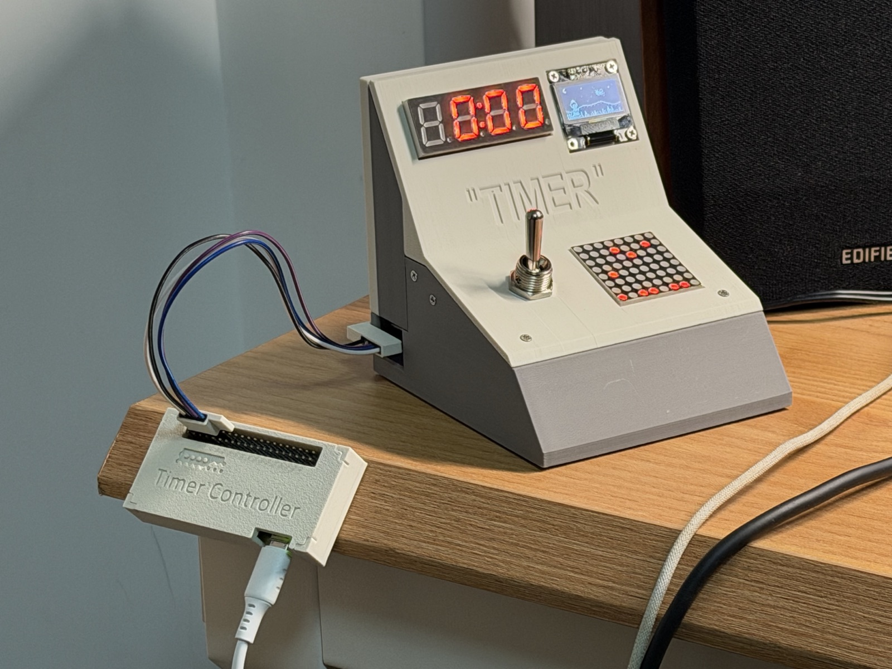
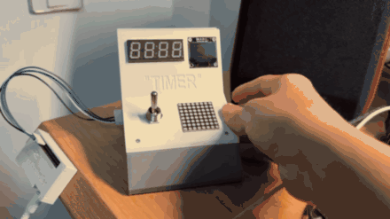
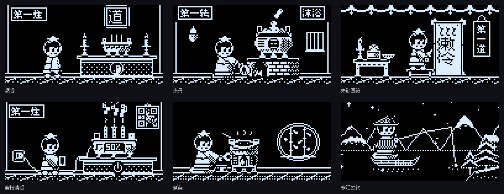
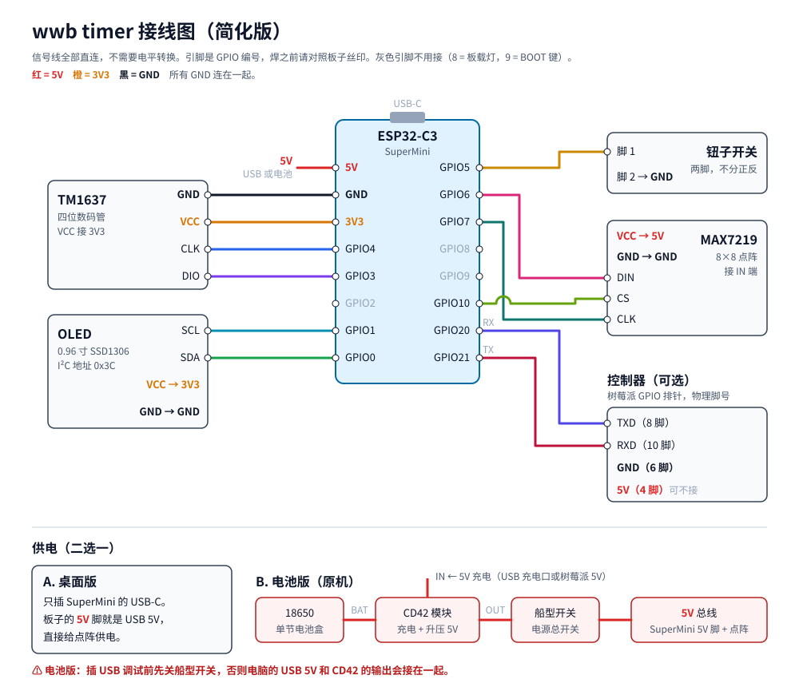

<p align="center"><a href="README.md">English</a> · <b>简体中文</b></p>

<h1 align="center">wwb timer</h1>

<p align="center">
  一台拨一下开关就开始计时的桌面小机器：ESP32-C3 + OLED + 数码管 + 8×8 点阵。<br>
  不接电脑时自己计时，插上树莓派就变成可编程的三屏终端。
</p>

<p align="center">
  <a href="https://zijie-duan.github.io/wwb_timer/"><b>▶ 在线试玩</b></a> ·
  <a href="docs/build.zh-CN.md"><b>🔧 复刻指南</b></a> ·
  <a href="https://github.com/ZiJie-Duan/wwb_timer/releases"><b>⬇ 下载固件</b></a>
</p>

<p align="center">
  
</p>

<p align="center">
  
  
  
  
</p>

## 它能做什么

<p align="center">
  <br>
  <sub>开机动画，拨上开关开始计时</sub>
</p>

- **拨上开关计时，拨下停止。**  
  数码管显示累计的 `时:分`，OLED 显示秒数和一分钟进度条，每完成一次“开 → 关”，点阵上多亮一个点。时间存在芯片里，断电不丢。

- **插上控制器解锁更多玩法。**  
  树莓派通过串口接管三块屏，运行 Python 程序；拔掉后自动交还给芯片里的计时器，计时不中断。

- **dao timer：道家赛博计时器。**  
  开关拨上开一场法事（燃香、画符、炼丹……55 种），拨下是歇（煮茶、听雨、寒江独钓……54 种），全部是 1 位像素动画。

- **网页模拟器。**  
  不用硬件也能玩：芯片上的计时器源码同时编译成 WebAssembly，在浏览器里跑的就是同一份程序。

- **高速串口 API。**  
  设备端是一套二进制协议，OLED 整帧 95 fps、点阵约 2.7 万帧/s，可以拿来做自己的程序。

<p align="center"></p>

## 自己做一台

不需要画 PCB，也不需要蚀刻：所有芯片都在现成模块上，照着接线图连二十来根线就行。桌面版物料约 **45 元**，电池版约 **70 元**（不含打印和树莓派）。

<p align="center"><a href="docs/build.zh-CN.md#2-接线"></a></p>

[**复刻指南 →**](docs/build.zh-CN.md)：物料清单（带淘宝关键词和参考价）、接线、供电、3D 打印外壳、组装、刷固件、排错。

| 器件 | 型号 |
|---|---|
| 主控 | ESP32-C3 SuperMini |
| OLED | 0.96 寸 SSD1306，I²C |
| 数码管 | TM1637 0.56 寸四位，带冒号 |
| 点阵 | MAX7219 8×8 |
| 开关 | 钮子开关（任意两脚开关） |
| 电池版 | 18650 + CD42 充放电模块 + 船型开关 |
| 控制器（可选） | 树莓派 Zero 2 W |
| 外壳 | 3D 打印，Fusion 360 源文件在 [`hardware/enclosure/`](hardware/enclosure/) |

## 快速开始

**刷固件**：从 [Releases](https://github.com/ZiJie-Duan/wwb_timer/releases) 下载 `.bin`，然后

```bash
pip install esptool
esptool --chip esp32c3 write_flash 0x0 wwb_timer-v0.2.0-esp32c3.bin
```

或者从源码编译：`pip install platformio && cd firmware && pio run -t upload`。

**用电脑控制**（串口自动识别；树莓派上设 `WWB_PORT=/dev/serial0`）：

```bash
pip install -e host
python -m wwb info                   # 设备信息
python -m wwb text "你好" -f 5       # OLED 写中文
python -m wwb seg 12:34              # 数码管
python -m wwb events                 # 实时打印开关事件
python -m wwb.showcase               # 赛博风多场景演示（拨开关切场景）
python -m apps.dao                   # dao timer
```

**不接设备，在浏览器里跑**：

```bash
python -m wwb.sim                    # 打开 http://127.0.0.1:8765，右侧选程序运行，点击或按空格拨开关
```

没有程序运行时，网页里跑的是芯片上同一份脱机计时器（WebAssembly）；运行一个 Python 程序 = 插入控制器。模拟器按固件逐条执行协议命令，并模拟真机的刷新时序，实测刷新数和真机相差 1% 左右。程序放在 `apps/<名字>/`，同一个程序加 `--port sim` 跑在模拟器上，去掉就跑在真机上。详见 [docs/simulator.md](docs/simulator.zh-CN.md)。

## 文档

| 文档 | 内容 |
|---|---|
| [build.md](docs/build.zh-CN.md) | **复刻指南** |
| [hardware.md](docs/hardware.zh-CN.md) | 器件、GPIO、供电、原机实测结论 |
| [offline.md](docs/offline.zh-CN.md) | 芯片里的计时器 wwb timer：操作、动画、怎么写脱机程序 |
| [dao.md](docs/dao.zh-CN.md) | dao timer：规则和全部场景一览 |
| [simulator.md](docs/simulator.zh-CN.md) | 网页模拟器 |
| [raspberrypi.md](docs/raspberrypi.zh-CN.md) | 树莓派作控制器（UART）、开机自启 |
| [protocol.md](docs/protocol.zh-CN.md) | 串口协议规范 |
| [benchmarks.md](docs/benchmarks.zh-CN.md) | 性能极限实测 |

每篇文档都有英文版（去掉文件名里的 `.zh-CN`）。

## 目录

```
firmware/            ESP32-C3 固件（PlatformIO + Arduino 3.3 / ESP-IDF 5.5）
  src/board.h        引脚分配
  src/proto.*        帧格式、操作码、COBS/CRC
  src/transport.*    USB-Serial/JTAG 与 UART1 收发层
  src/oled.*         SSD1306：帧缓冲 + 脏矩形 + 推送任务
  src/seg.*          TM1637：定时器中断驱动时序，只写变化的位
  src/matrix.*       MAX7219：硬件 SPI，旋转换算，只写变化的行
  src/io.*           开关 / BOOT 键（中断时间戳）+ 板载灯
  src/main.cpp       命令分发、INFO/STATS、设备端自测
  src/offline.*      脱机程序在芯片上的运行环境（控制器接管、NVS 存储）
native/              脱机程序（C++，芯片与网页共用）
  wwb/               框架：Device、Canvas（u8g2）、App、Runtime
  timer/             wwb timer
  web/, build_web.py 编译成 WebAssembly（web/js/native.js）
host/wwb/            上位机 Python 库
  device.py          Device 类：所有命令的 API
  protocol.py        协议常量与编解码
  bench.py           性能极限测试
  maxdemo.py         三屏同时全速演示
  showcase.py        赛博风多场景演示
  cli.py             命令行
  remote.py          把程序同步到树莓派并在那里运行（UART 驱动设备）
  sim.py             网页模拟器的 Python 桥
  app.py             程序入口 run(main)
apps/                程序，每个一个包（stopwatch：秒表；dao：道家赛博计时器）
web/                 网页模拟器
hardware/enclosure/  外壳 Fusion 360 源文件
docs/                文档和图片
results/             跑分原始数据（JSON）
```

## 关键数字

| | 极限 |
|---|---|
| USB 往返 | 0.28 ms |
| OLED 整帧 / 局部 | 95 fps / 236 fps（4×96 区域） |
| 数码管 | 390 次/s 整屏，800 次/s 单位 |
| 点阵 | 约 2.7 万帧/s（批量发送） |
| 三屏同时全速 | OLED 91 fps + 数码管 666/s + 点阵 14730/s |
| 三屏同时、限速 320 | OLED 96 fps + 数码管 319.7/s + 点阵 319.7/s，零丢帧 |
| 开关事件时间戳 | µs 级（取抖动开始时刻） |

详见 [docs/benchmarks.md](docs/benchmarks.zh-CN.md)。

## 注意

- 电池版插 USB 调试前先关电源开关，否则电脑的 USB 5V 会和电池升压输出接在一起。见 [docs/build.md](docs/build.zh-CN.md#3-供电)。
- ESP32-C3 的 IO 不耐 5V：TM1637 用 5V 供电时必须加电平转换，简化接法是让它用 3.3V。
- 在 Linux / macOS 上打开串口时要保持 DTR、RTS 同为有效，并关闭 HUPCL，否则会复位芯片。`wwb.Device` 已处理。

## 许可证

[MIT](LICENSE)。dao timer 用到的 Fusion Pixel 字体是 OFL 协议，见 `apps/dao/assets/fonts`。
