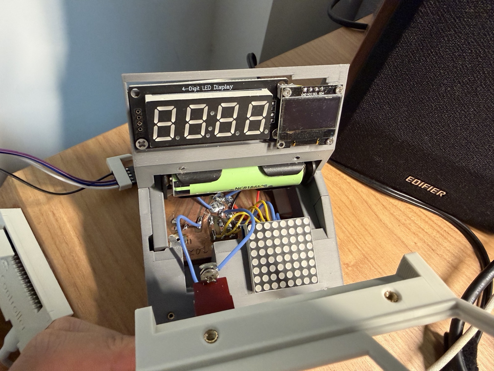
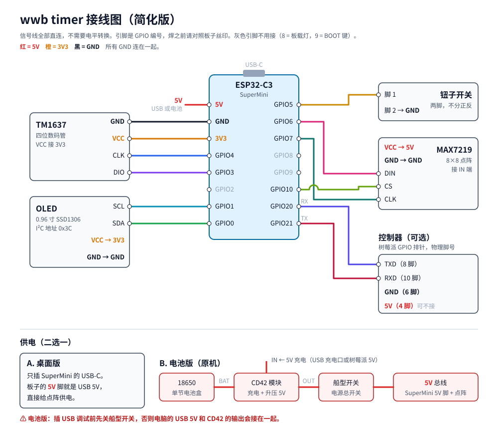
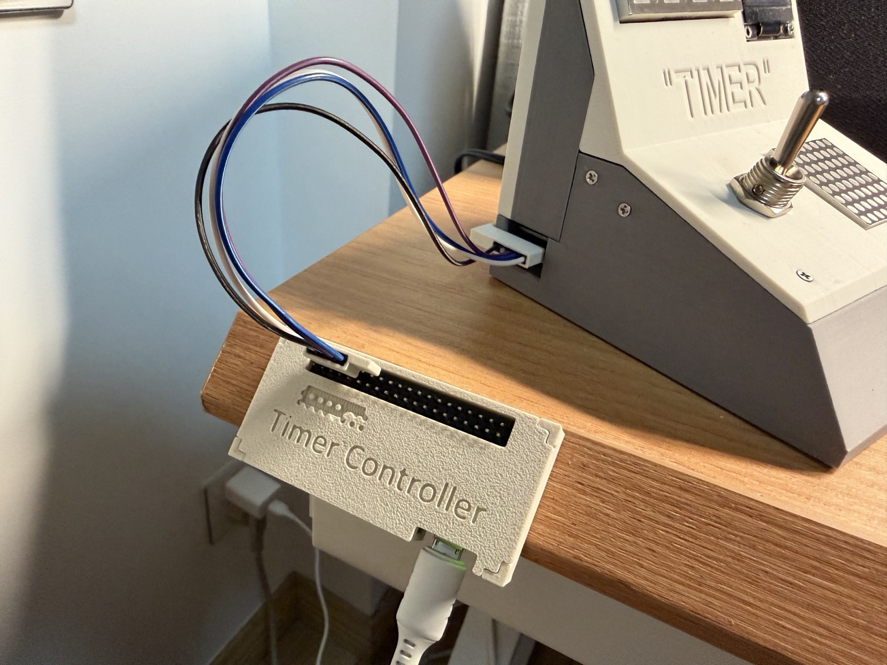
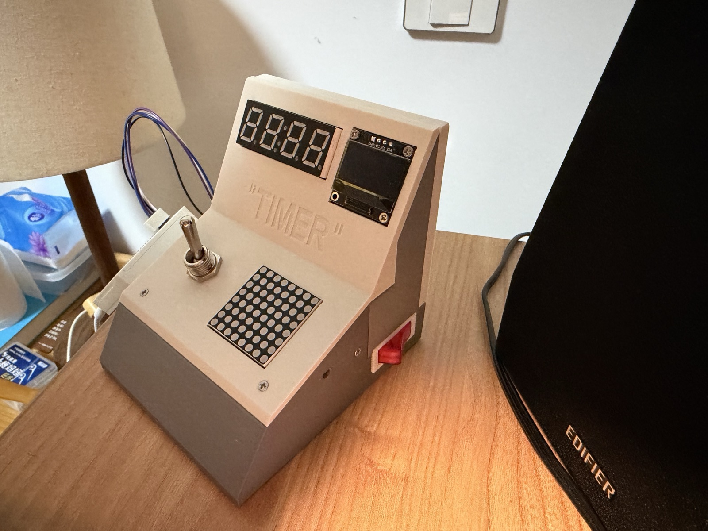
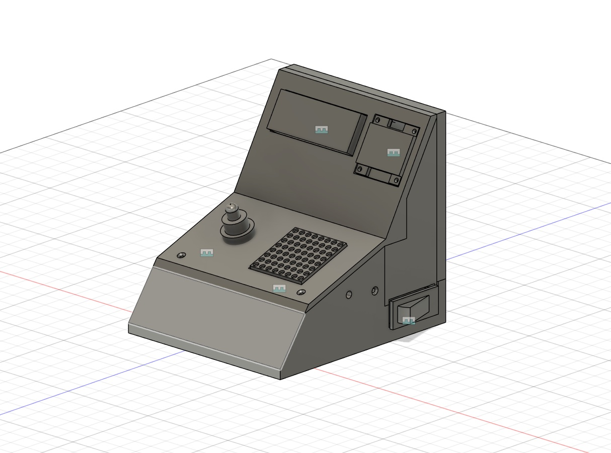
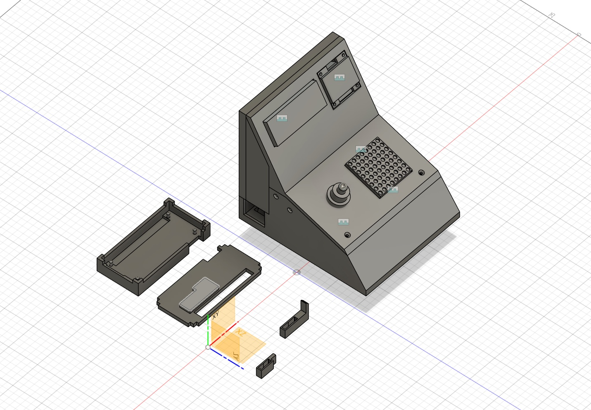
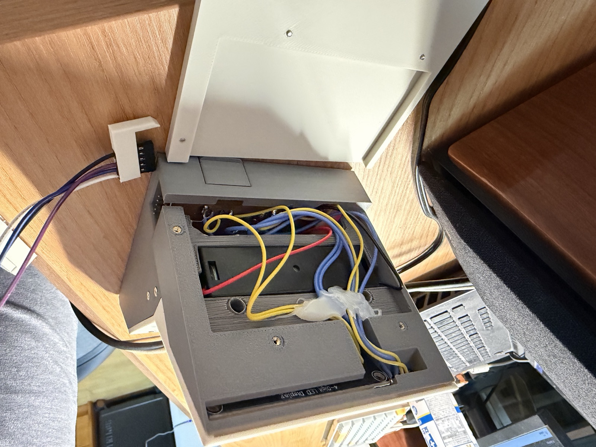
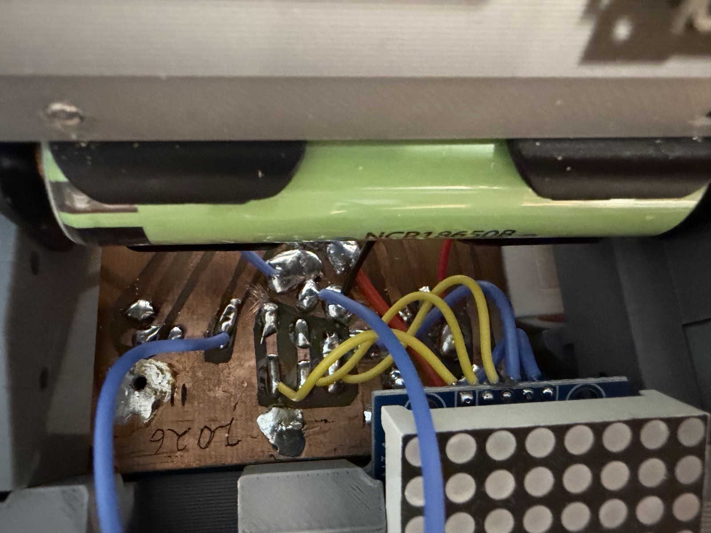
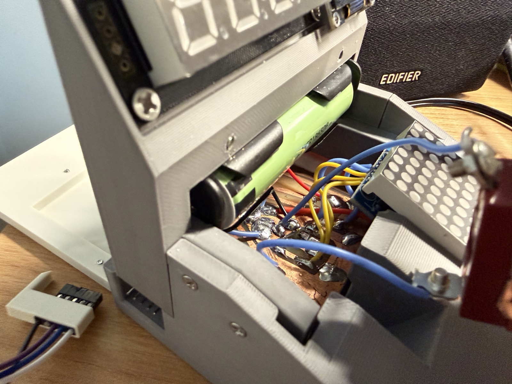
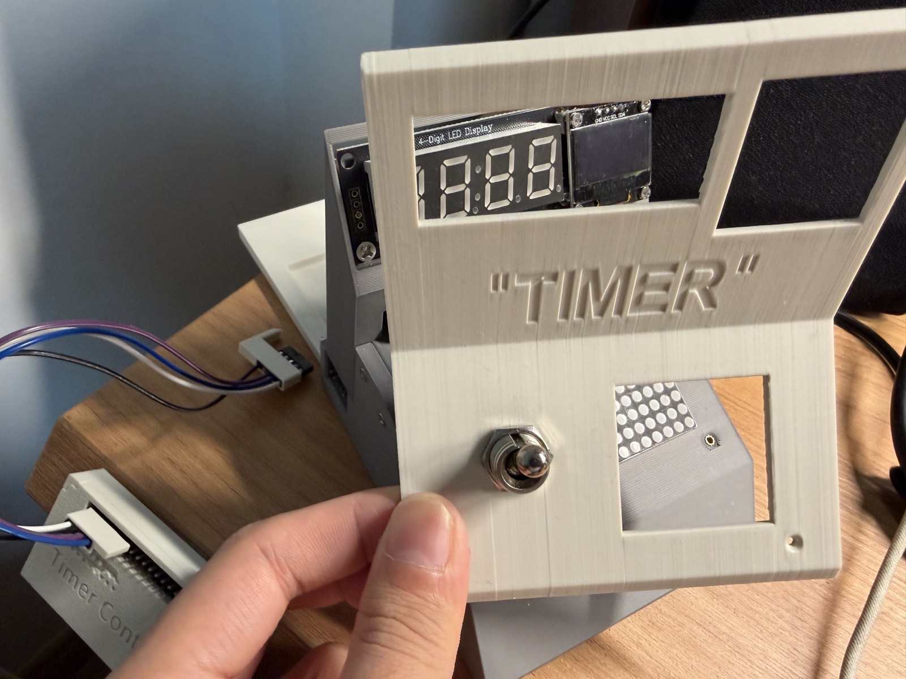

**English** · [简体中文](build.zh-CN.md)

# Build guide

<p align="center"></p>

The original unit was built on a hand-etched copper board with point-to-point wiring, and no schematic was ever drawn. Fortunately **every chip sits on an off-the-shelf module** (MCU, OLED, 4-digit display, matrix, charger), and the hand-made board only distributes power and signals. So a rebuild **needs no PCB**: wire about twenty connections following the table below, on jumper wires or perfboard.

This guide describes a cleaned-up, simplified wiring. It differs from the original only in signal levels: the original ran the 4-digit display and matrix at 5V through a level shifter (the exact part was not recorded); the simplified version powers the 4-digit display from 3.3V and drives the matrix signals directly, so **no level shifter is needed**. Pins, firmware and enclosure are identical to the original.

> **Verification status**: pin map, firmware and enclosure match the original, which runs daily. The no-level-shifter wiring is a common way to drive these modules from an ESP32, but it has not yet been tested on this exact build. If something misbehaves, see [7. Troubleshooting](#7-troubleshooting), and issues are welcome.

Contents:

1. [Bill of materials](#1-bill-of-materials)
2. [Wiring](#2-wiring)
3. [Power](#3-power)
4. [Enclosure](#4-enclosure-3d-printed)
5. [Assembly](#5-assembly)
6. [Flashing the firmware](#6-flashing-the-firmware)
7. [Troubleshooting](#7-troubleshooting)

## 1. Bill of materials

Prices are what the original parts cost on Taobao in October 2026 (¥1 ≈ $0.14), for reference only. The search terms in the second column work on Taobao; AliExpress sells the same modules under the English names.

### Required (desk version, about ¥45)

| Part | Search term / spec | Qty | Price | Notes |
|---|---|---|---|---|
| MCU | `ESP32-C3 SuperMini` | 1 | ¥12 | Get the unsoldered version, easier to wire directly |
| OLED | `0.96寸 OLED IIC 白色` (0.96" OLED I2C) | 1 | ¥11 | Must be the **4-pin I²C** version (GND VCC SCL SDA) with an SSD1306, not the 7-pin SPI one |
| 4-digit display | `TM1637 0.56寸 四位 数码管 时钟模块` (TM1637 0.56" clock display) | 1 | ¥6 | The clock version **with a center colon** |
| LED matrix | `MAX7219 8x8 点阵模块 单个` (MAX7219 8x8 single) | 1 | ¥5 | One 8×8 block |
| Switch | `KL-C101 钮子开关 2脚2档` (2-pin toggle switch) | 1 | ¥7 | M12 thread, the enclosure hole is sized for it; any 2-pin switch works electrically |
| Wire | `硅胶线 26AWG` / `28AWG` (silicone wire) | 1 roll | ¥5 | For signals; 22–24 AWG for power |

### Battery version adds (about ¥25)

| Part | Search term / spec | Qty | Price | Notes |
|---|---|---|---|---|
| Cell | `18650 3500mAh 尖头` (button top) | 1 | ¥20 | The original uses an NCR18650B |
| Cell holder | `18650 电池盒 单节 带线` (single, with leads) | 1 | ¥1.3 | The enclosure has a 76×21×19 mm slot for it |
| Charge module | `CD42 充放电一体 5V 升压` (CD42 charge/boost) | 1 | ¥2.4 | One board for charging, protection and 5V boost |
| Power switch | `KCD3 船型开关 3脚2档` (KCD3 rocker, 3-pin) | 1 | ¥0.8 | The enclosure hole is sized for KCD3 |

### Controller (optional)

| Part | Spec | Qty | Notes |
|---|---|---|---|
| Raspberry Pi | Raspberry Pi Zero 2 W | 1 | Runs dao timer and other Python programs; the device works without it |
| Cable | 2.54 mm 5-pin female housing + 4 wires | 1 | Plugs onto Pi header pins 2–10, see [wiring](#controller-optional) |

### Enclosure and tools

- PLA filament; the print is about 100×110×110 mm.
- M2 and M3 heat-set brass inserts, M2/M3 countersunk Phillips screws 5–8 mm long. The original's screw lengths were found by trial while assembling, so an assorted box is easiest.
- Soldering iron, multimeter, hot glue. Etchant and toner-transfer paper are **not** needed.

## 2. Wiring

<p align="center"></p>

All pins below are **GPIO numbers**; check them against the SuperMini's silkscreen before soldering.

| Module | Module pin | SuperMini |
|---|---|---|
| OLED | GND | GND |
| | VCC | **3V3** |
| | SCL | GPIO1 |
| | SDA | GPIO0 |
| TM1637 4-digit display | GND | GND |
| | VCC | **3V3** |
| | CLK | GPIO4 |
| | DIO | GPIO3 |
| MAX7219 matrix (**IN side**) | VCC | **5V** |
| | GND | GND |
| | DIN | GPIO6 |
| | CS | GPIO10 |
| | CLK | GPIO7 |
| Toggle switch | one pin | GPIO5 |
| | other pin | GND |

Leave unconnected: GPIO8 is the onboard blue LED and GPIO9 the BOOT button (the firmware uses both, nothing to wire); GPIO2 is unused.

### Why no level shifter

ESP32-C3 pins are 3.3V and **must not see 5V signals**.

- The **OLED** is a 3.3V part anyway.
- The **TM1637** powered from 3.3V also has its on-board pull-ups at 3.3V, so the DIO line never exceeds what the chip tolerates. The digits are slightly dimmer than at 5V.
  ⚠ If you power the TM1637 from 5V you **must** add a level shifter (as the original did), otherwise 5V flows into the ESP32 through DIO.
- The **MAX7219** needs a 5V supply, and the ESP32 drives its inputs at 3.3V. The datasheet asks for ≥3.5V high level, so 3.3V is slightly out of spec, but this is the usual way ESP32 projects drive these matrices and it generally works. If the matrix glitches now and then, see [Troubleshooting](#7-troubleshooting).

### Controller (optional)

<p align="center"></p>

The Raspberry Pi's hardware UART on its GPIO header connects to the ESP32's UART1. Both sides are 3.3V, so they connect directly.

| Raspberry Pi (physical pin) | | SuperMini |
|---|---|---|
| pin 8 TXD (GPIO14) | → | GPIO20 (RX) |
| pin 10 RXD (GPIO15) | ← | GPIO21 (TX) |
| pin 6 GND | — | GND |
| pin 4 5V | → | CD42 charge input (battery version, optional: charges the cell whenever the Pi is connected) |

Pins 2, 4, 6, 8 and 10 on the outer row of the Pi header are 5V, 5V, GND, TXD and RXD, so a single 5-pin housing covers them and is hard to plug in wrong. On the original, a printed clip (the "线夹" cable clip parts in the model) holds the plug. Pi system settings are in [raspberrypi.md](raspberrypi.md).

## 3. Power

<p align="center"></p>

**A. Desk version**: just plug USB-C into the SuperMini. Its 5V pin carries USB 5V and powers the matrix; the 3V3 pin powers the OLED and the 4-digit display. No battery, fewest wires.

**B. Battery version (the original)**:

```
18650 ── BAT ──> CD42 ── OUT 5V ──> rocker switch ──> 5V rail (SuperMini 5V pin + matrix VCC)
                  ^
                  └── IN: 5V charging input (a USB charging port, or the Pi's 5V)
```

- The CD42 is an all-in-one charge/discharge module: BAT goes to the cell, OUT supplies 5V, IN takes 5V for charging, and it can charge while in use.
- The rocker switch sits on the CD42's 5V output as the main power switch. For a 3-pin illuminated rocker, use a multimeter to find the two pins that switch; the third one is for the lamp.
- Connect all grounds together.
- ⚠ **Switch the rocker off before plugging in USB for debugging.** The SuperMini's USB 5V is tied straight to its 5V pin, so with the switch on, the computer's 5V would be connected to the CD42 output.
- ⚠ An 18650 can deliver a lot of current. Take the cell out before soldering and never let its terminals touch.

## 4. Enclosure (3D printed)

<p align="center"> </p>

The model was made in Fusion 360. The source is [`hardware/enclosure/timer.f3z`](../hardware/enclosure/timer.f3z), and it already contains reference models of every part (ESP32, OLED, 4-digit display, matrix, cell holder, CD42, both switches), so you can check positions and cutouts directly.

Main parts (names as they appear in the model):

| Part (name in the model) | Description |
|---|---|
| 面板 (front panel) | White front panel with the "TIMER" lettering; holds the toggle switch, window for the matrix |
| 屏幕支架 (screen bracket) | Holds the 4-digit display (M3) and the OLED (M2) |
| 底座, 后面板 (base, back panel) | Grey main body for the cell holder and electronics; side cutouts for the rocker switch and controller plug |
| 调试盖 (debug cover) | Small hatch on the back of the base; open it to reach USB |
| 线夹1, 线夹2 (cable clips) | Clips for the plugs on both ends of the controller cable |
| Pi 底座, pi盖子 (Pi base, Pi lid) | Small case for the Raspberry Pi Zero 2 W ("Timer Controller") |

Print suggestions (the original is PLA in two colors): 0.2 mm layers, 3 walls, 15–20% infill; print the front panel lettering side down. Press M2/M3 heat-set inserts into the screw holes and find screw lengths by trial fit.

## 5. Assembly

1. **Test on the bench before building it into the case.** Connect the four modules to the SuperMini with jumper wires following the [wiring table](#2-wiring), flash the firmware ([section 6](#6-flashing-the-firmware)), and check that all three displays light up and the switch starts and stops the timer. Only then solder everything into the enclosure.
2. Press the heat-set inserts into the enclosure.
3. Mount the 4-digit display and OLED on the screen bracket; mount the toggle switch and matrix on the front panel.
4. Put the cell holder and CD42 in the base (battery version). The original uses a hand-etched board to hold the SuperMini and split out 5V/3V3/GND; a 5×7 cm piece of perfboard does the same job: solder three bus lines (5V, 3V3, GND) and take every module's power from there.
5. Tidy the wires, hot-glue the bundles to the inside walls, and close the front and back panels.

Inside the original, for reference:

| | |
|---|---|
|  |  |
| Back: display leads hot-glued in place, cell holder below | The hand-etched board under the cell |
|  |  |
| Side: cell, board, matrix, toggle switch | Front panel |

## 6. Flashing the firmware

**Prebuilt firmware (recommended)**: download `wwb_timer-<version>-esp32c3.bin` from [Releases](https://github.com/ZiJie-Duan/wwb_timer/releases). It is a merged full image, written at address 0:

```bash
pip install esptool
esptool --chip esp32c3 write_flash 0x0 wwb_timer-<version>-esp32c3.bin
```

Without Python, flash from the browser (Chrome / Edge): open [ESP Tool](https://espressif.github.io/esptool-js/), click Connect and pick the serial port, choose the `.bin` file, set the address to `0x0`, and click Program.

**Build from source**:

```bash
pip install platformio
cd firmware
pio run -t upload          # finds the port automatically; add --upload-port <port> if it doesn't
```

If flashing fails, hold the BOOT button on the SuperMini while plugging in USB to enter download mode, then retry.

After flashing, the displays play the boot animation and show "wwb timer"; flip the switch up to start timing and down to stop, and the matrix gains a dot for every completed session. Controls are described in [offline.md](offline.md).

Check the device from a computer:

```bash
pip install -e host
python -m wwb info         # firmware version and the state of every part
python -m wwb text "hello" -f 5
python -m wwb seg 12:34
```

## 7. Troubleshooting

| Symptom | Check |
|---|---|
| OLED stays dark | Is it an SSD1306, 4-pin I²C version? SDA/SCL swapped? Some OLED modules are labelled VCC GND in that order, don't swap power |
| Digits dark / garbled | CLK and DIO swapped? VCC on 3V3? |
| Matrix dark | VCC must be **5V**; signals go to the **IN side** (the DIN side), not OUT |
| Matrix glitches now and then | Not enough margin on the 3.3V signals. First try a lower SPI clock: `python -m wwb mxcfg --spi 1000000` (reverts on reboot); the permanent fix is a 74AHCT125 powered from 5V as a buffer on DIN/CLK/CS |
| Matrix rotated | The firmware rotates 90° clockwise by default to match the original's mounting. Temporarily: `python -m wwb mxcfg --rotation 0`; permanently: `rotation` in `firmware/src/matrix.cpp` |
| Switch works upside down | A 2-pin switch has no polarity; mount it rotated 180° |
| No serial port for flashing | Use a USB cable that carries data; hold BOOT while plugging in |
| Battery version won't turn on | Is the rocker switch on? 5V at the CD42 OUT? Is the cell charged (feed 5V to the CD42 IN for a while)? |

More hardware details and measurements from the original unit are in [hardware.md](hardware.md).
