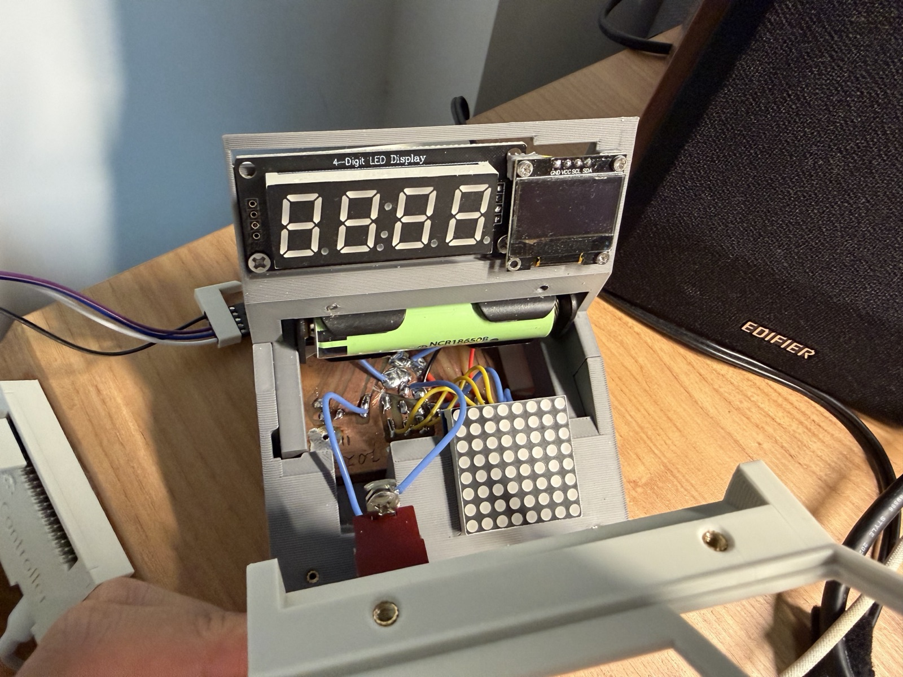
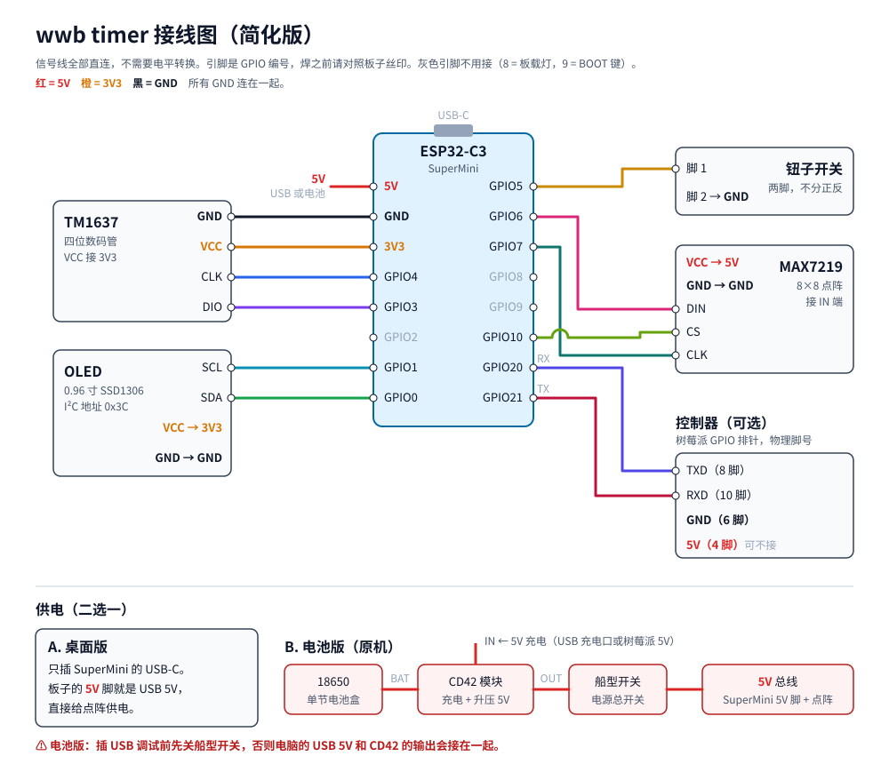
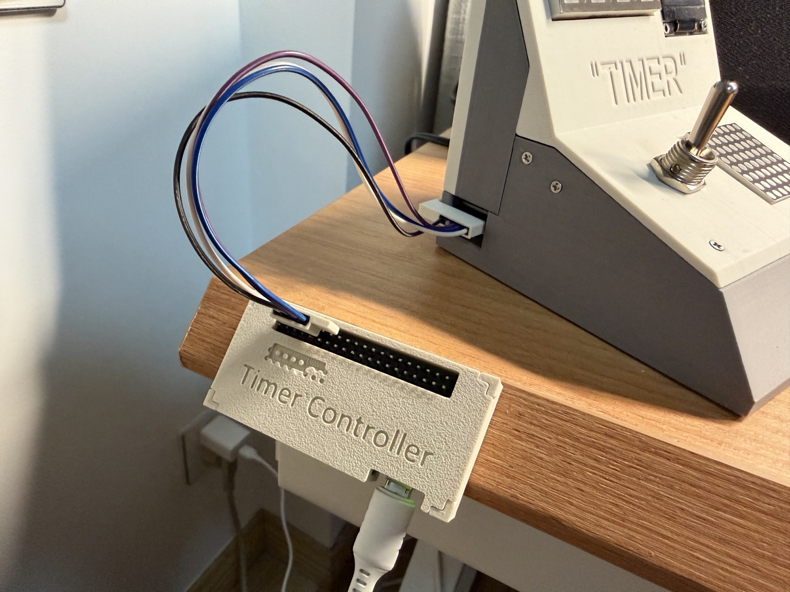
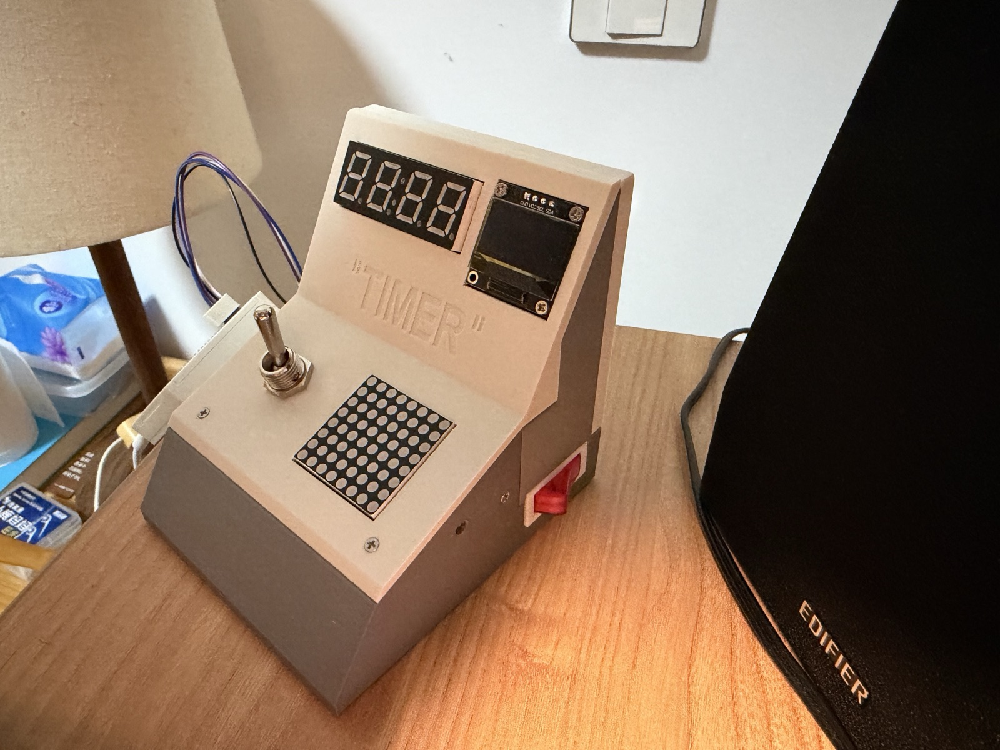
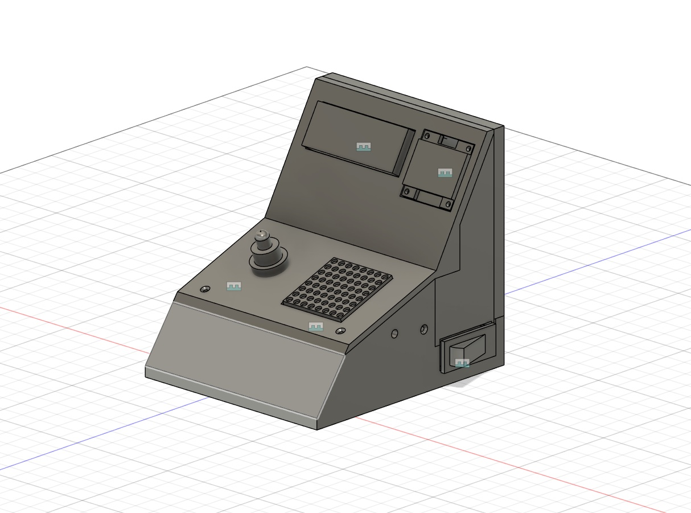
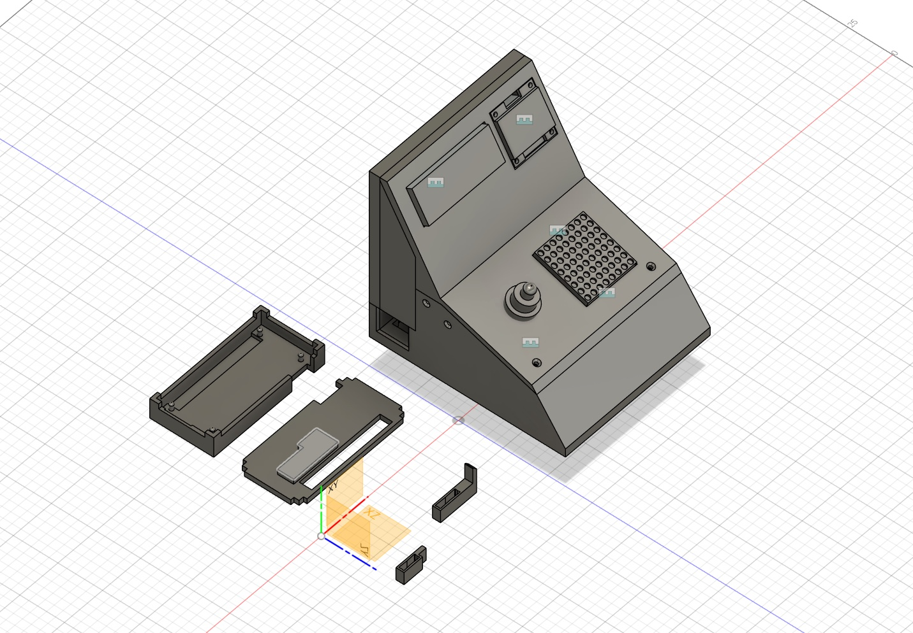
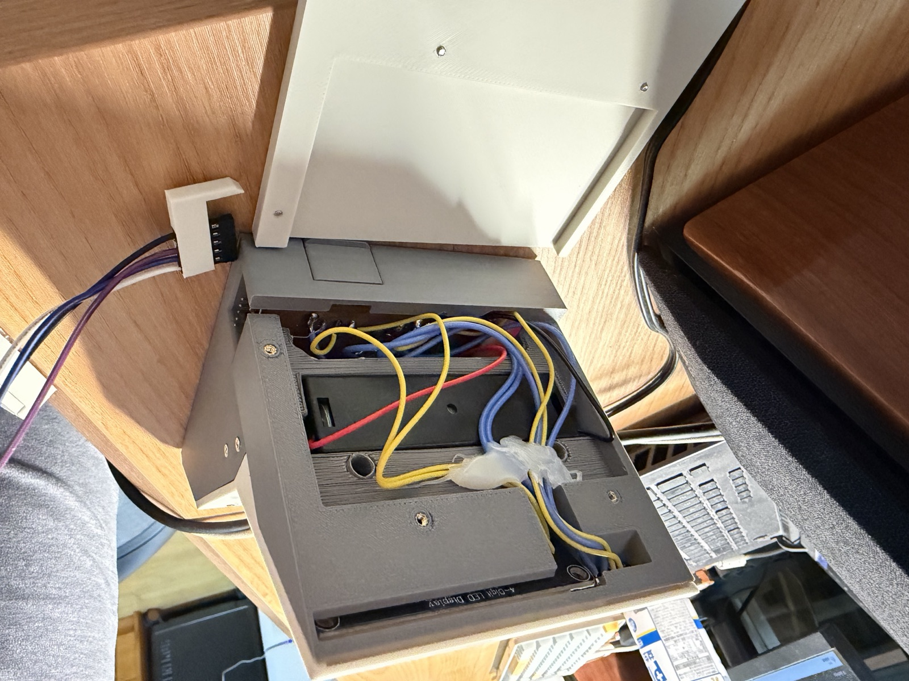
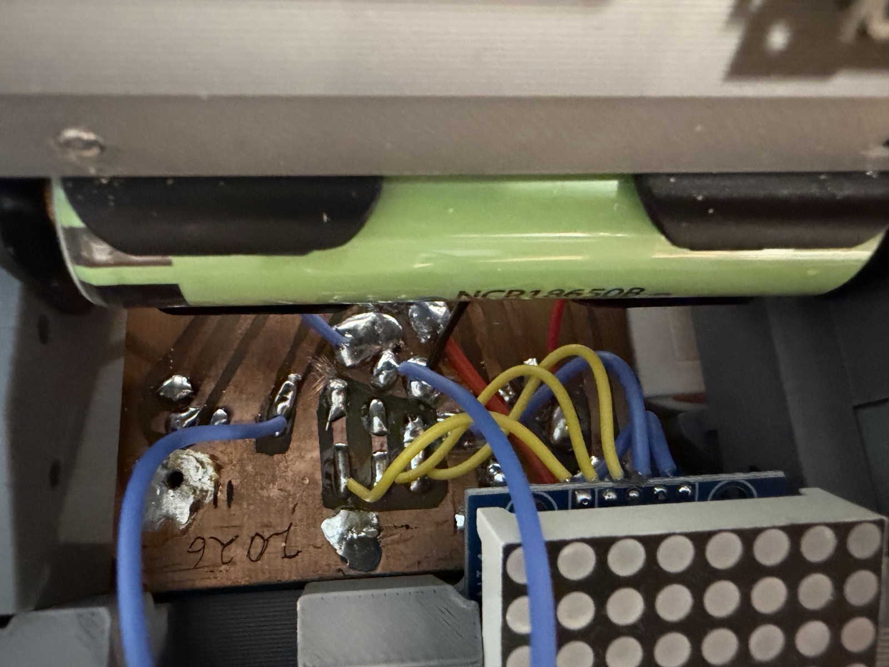
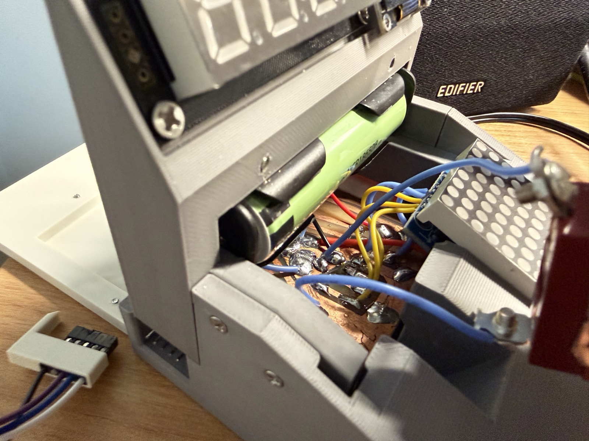
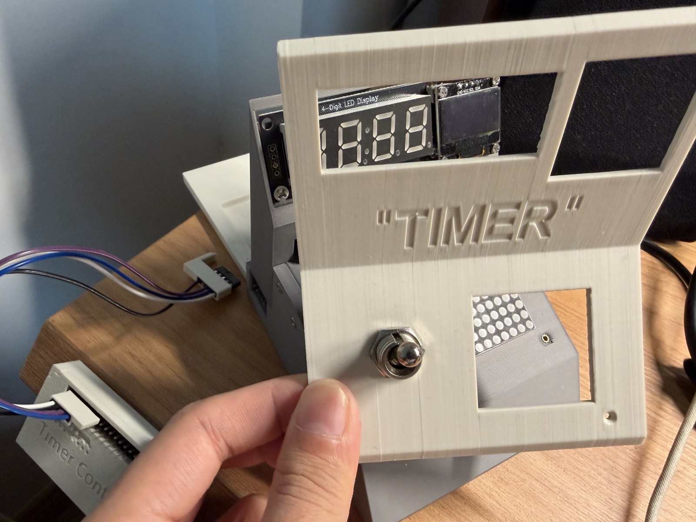

[English](build.md) · **简体中文**

# 复刻指南

<p align="center"></p>

原机的电路是手工蚀刻的覆铜板加飞线焊成的，没有留下图纸。好在**所有芯片都在现成模块上**（主控、OLED、数码管、点阵、充放电），自制板只负责分线和供电。所以复刻**不需要做 PCB**：照下面的接线表连二十来根线就行，杜邦线、万用板都可以。

本文的接法是整理过的简化版，和原机的区别只在电平：原机给数码管和点阵供 5V，信号经过电平转换（型号已经记不清了）；简化版把数码管改用 3.3V 供电，点阵信号直连，整台机器**不需要电平转换**。引脚、固件、外壳和原机完全一样。

> **验证状态**：引脚分配、固件、外壳都和原机一致，已经实际运行过。不用电平转换的简化接法是 ESP32 驱动这几个模块的常见做法，但还没有在这台机器上实测过。遇到问题请看[第 7 节 排错](#7-排错)，也欢迎提 issue。

目录：

1. [物料清单](#1-物料清单)
2. [接线](#2-接线)
3. [供电](#3-供电)
4. [外壳](#4-外壳3d-打印)
5. [组装](#5-组装)
6. [刷固件](#6-刷固件)
7. [排错](#7-排错)

## 1. 物料清单

价格是 2026 年 10 月在淘宝买的实际成交价，仅供参考。关键词可以直接拿去搜。

### 必需（桌面版，约 45 元）

| 器件 | 搜索关键词 / 规格 | 数量 | 参考价 | 注意 |
|---|---|---|---|---|
| 主控 | `ESP32-C3 SuperMini` | 1 | ¥12 | 买“不焊接”版本，方便直接焊线 |
| OLED | `0.96寸 OLED IIC 白色` | 1 | ¥11 | 要 **4 针 I²C** 版（GND VCC SCL SDA），驱动 SSD1306；不要 7 针 SPI 版 |
| 数码管 | `TM1637 0.56寸 四位 数码管 时钟模块` | 1 | ¥6 | 要**中间带冒号**的时钟版 |
| 点阵 | `MAX7219 8x8 点阵模块 单个` | 1 | ¥5 | 单块 8×8，共阴红色 |
| 开关 | `KL-C101 钮子开关 2脚2档` | 1 | ¥7 | M12 螺纹，外壳按它开孔；任何两脚开关都能用 |
| 导线 | `硅胶线 26AWG` 或 `28AWG` | 1 卷 | ¥5 | 信号线；电源线可以用 22–24AWG |

### 电池版再加（约 25 元）

| 器件 | 搜索关键词 / 规格 | 数量 | 参考价 | 注意 |
|---|---|---|---|---|
| 电芯 | `18650 3500mAh 尖头` | 1 | ¥20 | 原机用的是 NCR18650B |
| 电池盒 | `18650 电池盒 单节 带线` | 1 | ¥1.3 | 外壳里按 76×21×19mm 留的位置 |
| 充放电模块 | `CD42 充放电一体 5V 升压` | 1 | ¥2.4 | 一块板同时负责充电、保护、升压到 5V |
| 电源开关 | `KCD3 船型开关 3脚2档` | 1 | ¥0.8 | 外壳按 KCD3 尺寸开孔 |

### 控制器（可选）

| 器件 | 规格 | 数量 | 注意 |
|---|---|---|---|
| 树莓派 | Raspberry Pi Zero 2 W | 1 | 跑 dao timer 等 Python 程序；不接也能用，芯片里自带计时器 |
| 连接线 | 2.54mm 5P 杜邦排母 + 4 根线 | 1 | 插在树莓派排针 2–10 脚上，见[接线](#控制器可选) |

### 外壳和工具

- PLA 耗材，打印尺寸约 100×110×110mm。
- M2、M3 热熔铜螺母各若干，十字沉头螺丝 M2/M3、长 5–8mm 若干。原机的螺丝长度是装的时候试出来的，建议买一盒混装。
- 电烙铁、万用表、热熔胶。手工蚀刻的蚀刻剂、转印纸**都不需要**。

## 2. 接线

<p align="center"></p>

下表里的引脚都是 **GPIO 编号**，焊之前请对照 SuperMini 板子上的丝印。

| 模块 | 模块引脚 | 接 SuperMini |
|---|---|---|
| OLED | GND | GND |
| | VCC | **3V3** |
| | SCL | GPIO1 |
| | SDA | GPIO0 |
| TM1637 数码管 | GND | GND |
| | VCC | **3V3** |
| | CLK | GPIO4 |
| | DIO | GPIO3 |
| MAX7219 点阵（**IN 端**） | VCC | **5V** |
| | GND | GND |
| | DIN | GPIO6 |
| | CS | GPIO10 |
| | CLK | GPIO7 |
| 钮子开关 | 一脚 | GPIO5 |
| | 另一脚 | GND |

不接的引脚：GPIO8 是板载蓝灯，GPIO9 是 BOOT 键，固件都会用到，但不用外接；GPIO2 不用。

### 为什么不需要电平转换

ESP32-C3 的 IO 是 3.3V 的，**不能接 5V 信号**。

- **OLED** 本身就是 3.3V 器件。
- **TM1637** 用 3.3V 供电后，模块上的上拉电阻也只拉到 3.3V，DIO 线读回来的电平不会超过芯片上限。代价是数码管比 5V 供电时略暗。
  ⚠ 如果 TM1637 改接 5V，就**必须**加电平转换（原机的做法），否则 5V 会经过 DIO 灌进 ESP32。
- **MAX7219** 要 5V 供电，信号由 ESP32 用 3.3V 直接驱动。数据手册要求高电平 ≥3.5V，3.3V 略低于规格，但这是 ESP32 驱动点阵的常见接法，一般能正常工作。如果点阵偶尔花屏，见[排错](#7-排错)。

### 控制器（可选）

<p align="center"></p>

树莓派用 GPIO 上的硬件串口接 ESP32 的 UART1，两边都是 3.3V，可以直连。

| 树莓派（物理脚号） | | SuperMini |
|---|---|---|
| 8 脚 TXD（GPIO14） | → | GPIO20（RX） |
| 10 脚 RXD（GPIO15） | ← | GPIO21（TX） |
| 6 脚 GND | — | GND |
| 4 脚 5V | → | CD42 充电输入（电池版可选，接上树莓派就给电池充电） |

树莓派排针外侧一排的 2、4、6、8、10 脚依次是 5V、5V、GND、TXD、RXD，一个 5P 排母正好插满，不容易插错。原机的插头外面套了一个打印的卡扣（模型里的“线夹”）。树莓派系统要做的设置见 [raspberrypi.md](raspberrypi.zh-CN.md)。

## 3. 供电

<p align="center"></p>

**A. 桌面版**：只插 SuperMini 的 USB-C。板子的 5V 脚就是 USB 的 5V，直接给点阵供电；3V3 脚给 OLED 和数码管供电。不用电池，接线最少。

**B. 电池版（原机）**：

```
18650 ── BAT ──> CD42 ── OUT 5V ──> 船型开关 ──> 5V 总线（SuperMini 的 5V 脚 + 点阵 VCC）
                  ^
                  └── IN：5V 充电输入（USB 充电口，或树莓派的 5V）
```

- CD42 是充放电一体模块：BAT 接电芯，OUT 输出 5V，IN 接 5V 充电，可以边充边用。
- 船型开关串在 CD42 的 5V 输出上，做总电源开关。3 脚带灯的船型开关，用万用表找出随开关通断的那两脚即可，第三脚是灯。
- 所有 GND 连在一起。
- ⚠ **插 USB 调试前先关船型开关。** SuperMini 的 USB 5V 和 5V 脚是直通的，开关开着时插 USB，电脑的 5V 会和 CD42 的输出接在一起。
- ⚠ 18650 能放出很大电流，焊接前先把电芯取下来，正负极不要碰到一起。

## 4. 外壳（3D 打印）

<p align="center"> </p>

模型是 Fusion 360 做的，源文件在 [`hardware/enclosure/timer.f3z`](../hardware/enclosure/timer.f3z)，里面已经放好了每个器件的参考模型（ESP32、OLED、数码管、点阵、电池盒、CD42、两个开关），可以直接看各个器件的位置和开孔。

主要零件：

| 零件（模型里的名字） | 说明 |
|---|---|
| 面板 | 白色前面板，带 “TIMER” 字样，装钮子开关、露出点阵 |
| 屏幕支架 | 装数码管（M3）和 OLED（M2） |
| 底座、后面板 | 灰色主体，放电池盒、电路板，侧面开船型开关孔、控制器插口 |
| 调试盖 | 底座背面的小盖子，打开后可以插 USB |
| 线夹 1、线夹 2 | 控制器连接线两端插头的卡扣 |
| Pi 底座、pi 盖子 | 树莓派 Zero 2 W 的小盒子（“Timer Controller”） |

打印建议（原机用 PLA，两种颜色）：层高 0.2mm，3 层壁，15–20% 填充；面板文字面朝下打印。螺丝孔处压 M2/M3 热熔铜螺母，螺丝长度装的时候试配。

## 5. 组装

1. **先不装壳，在桌上接好验证。** 用杜邦线按[接线表](#2-接线)把四个模块接到 SuperMini 上，刷好固件（[第 6 节](#6-刷固件)），确认三块屏都亮、拨开关能计时，再焊到外壳里。
2. 外壳螺丝孔压入热熔铜螺母。
3. 数码管、OLED 装到屏幕支架上；钮子开关、点阵装到面板上。
4. 底座里放电池盒和 CD42（电池版）。原机用一块手工蚀刻的板子固定 SuperMini、分出 5V/3V3/GND，复刻可以用一块 5×7cm 万用板代替：上面焊三条汇流线（5V、3V3、GND），各模块的电源线都从这里引出。
5. 理线，用热熔胶把线束固定在外壳内壁上，合上面板和后面板。

原机内部，仅供参考：

| | |
|---|---|
|  |  |
| 背面：屏幕引线用热熔胶固定，下面是电池盒 | 电池下方的手工蚀刻板 |
|  |  |
| 侧面：电芯、电路板、点阵、钮子开关 | 前面板 |

## 6. 刷固件

**用预编译固件（推荐）**：从 [Releases](https://github.com/ZiJie-Duan/wwb_timer/releases) 下载 `wwb_timer-<版本>-esp32c3.bin`。它是合并好的完整镜像，从地址 0 写入：

```bash
pip install esptool
esptool --chip esp32c3 write_flash 0x0 wwb_timer-<版本>-esp32c3.bin
```

不想装 Python，可以用浏览器刷（Chrome / Edge）：打开 [ESP Tool](https://espressif.github.io/esptool-js/)，点 Connect 选择串口，文件选这个 `.bin`，地址填 `0x0`，点 Program。

**从源码编译**：

```bash
pip install platformio
cd firmware
pio run -t upload          # 自动找串口；找不到时加 --upload-port <串口>
```

刷不进去时，按住 SuperMini 上的 BOOT 键再插 USB，进入下载模式后重试。

刷好后：屏幕播放开机动画，亮出 “wwb timer”；拨上开关开始计时，拨下停止，每完成一次点阵多亮一个点。操作说明见 [offline.md](offline.zh-CN.md)。

用上位机检查设备：

```bash
pip install -e host
python -m wwb info         # 打印固件版本、各器件状态
python -m wwb text "你好" -f 5
python -m wwb seg 12:34
```

## 7. 排错

| 现象 | 检查 |
|---|---|
| OLED 不亮 | 是不是 SSD1306、4 针 I²C 版；SDA/SCL 是否接反；有的 OLED 模块丝印是 VCC GND 顺序，别接反电源 |
| 数码管不亮 / 乱码 | CLK、DIO 是否接反；VCC 是否接在 3V3 |
| 点阵不亮 | VCC 要接 **5V**；信号要接 **IN 端**（DIN 那一侧），不是 OUT 端 |
| 点阵偶尔花屏 | 3.3V 信号余量不足。先降 SPI 时钟试试：`python -m wwb mxcfg --spi 1000000`（重启后恢复）；长期方案是在 DIN/CLK/CS 上加一片 5V 供电的 74AHCT125 做缓冲 |
| 点阵方向不对 | 固件默认顺时针转 90°，对应原机的安装方向。临时调整：`python -m wwb mxcfg --rotation 0`；永久修改：`firmware/src/matrix.cpp` 里的 `rotation` |
| 开关上下反了 | 两脚开关不分正反，把开关转 180° 装即可 |
| 刷固件找不到串口 | 换一根能传数据的 USB 线；按住 BOOT 再插 USB |
| 电池版开不了机 | 船型开关是否打开；CD42 的 OUT 是否有 5V；电芯是否有电（CD42 的 IN 接 5V 充一会儿） |

更多硬件细节和原机实测数据见 [hardware.md](hardware.zh-CN.md)。
